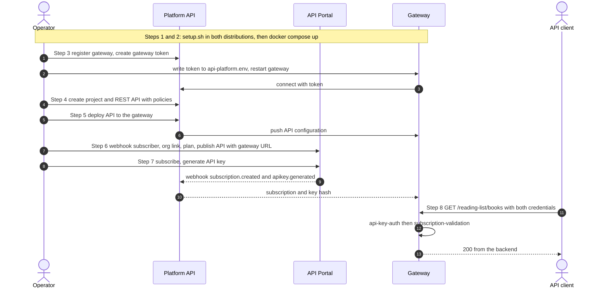

# WSO2 API Platform: gateway, API and API Portal end to end

Scripted, repeatable walk through the complete flow on one machine with Docker Compose: set up the stack,
register and start a gateway, create and deploy an API with policies, publish it in the API Portal with the
gateway URL as its server URL, subscribe, create an API key, and invoke the API.

The API is protected by two policies, and a request only succeeds when **both** credentials are valid:

| Credential | Header | Policy | Issued by |
|---|---|---|---|
| API key | `x-api-key` | `api-key-auth` | API Portal (`/apis/{id}/api-keys/generate`) |
| Subscription token | `Subscription-Key` | `subscription-validation` | API Portal (`/subscriptions`) |

Everything the scripts send is a plain JSON or YAML file under [`artifacts/`](artifacts), so you can change an
API, a policy or a plan by editing a file, not a script.

## Architecture


The numbered badges match the [steps below](#steps-scripts-and-artifacts). The gateway is the only teal element, the control plane
(Platform API and API Portal) is amber, the caller is blue and the backend is pink.

## Networks

The portal and the gateway are two independent compose projects. Compose prefixes every network with its project name,
so the networks they declare (`api-portal-network` in the portal, `gateway-network` in the gateway) are different networks and the containers cannot see each
other by service name.

| Path | Network | Address used | Configured by |
|---|---|---|---|
| Portal to Platform API (webhooks, login proxy) | portal project network | `https://platform-api:9243` | `artifacts/webhook-subscriber.json` (`targetUrl`) |
| Gateway controller to Platform API (control plane) | crosses networks through the host | `host.docker.internal:9243` | `CONTROLPLANE_HOST`, written to the gateway `api-platform.env` by step 3 |
| Your shell to every service | published ports on the host | `https://localhost:<port>` | `PLATFORM_API_URL`, `API_PORTAL_URL`, `GATEWAY_URL` |
| Gateway runtime to the backend | gateway project network, then outbound | backend URL in `artifacts/rest-api.json` | `upstream.main.url` |

Nothing needs to change for this: the shipped gateway compose file keeps its services on its own `gateway-network`,
which is already separate from the portal's network. Only one thing in the gateway distribution matters:

- **Keep `extra_hosts: host.docker.internal:host-gateway` on `gateway-controller`.** Docker Desktop on macOS and Windows
  resolves `host.docker.internal` by itself; on Linux this line is what makes it resolve.

(If you attach the gateway to an extra network of your own, for example to share one with the portal, define that network
under `networks:` in the gateway compose file. It is not required here.)

Prefer a single network? Create one external network, attach the `platform-api` service and the gateway services to it,
and set `CONTROLPLANE_HOST=platform-api:9243`. Nothing else in the scripts changes.

## The flow



## Steps, scripts and artifacts

| Step | What happens | Script | Artifacts used |
|---|---|---|---|
| 1 and 2 | Run `setup.sh` in both distributions, enable the Platform API webhook receiver, install the portal compose override, `docker compose up -d` for both | [`01-setup.sh`](scripts/01-setup.sh) | [`config/platform-api-webhook.toml`](config/platform-api-webhook.toml), [`config/portal-compose.override.yaml`](config/portal-compose.override.yaml) |
| 3 | Register the gateway, create its token, write it to the gateway env file, restart the gateway, wait until it is active | [`02-register-gateway.sh`](scripts/02-register-gateway.sh) | [`gateway.json`](artifacts/gateway.json) |
| 4 | Create the project and the REST API with `api-key-auth` and `subscription-validation` | [`03-create-api.sh`](scripts/03-create-api.sh) | [`project.json`](artifacts/project.json), [`rest-api.json`](artifacts/rest-api.json) |
| 5 | Attach the API to the gateway and deploy it, wait for `DEPLOYED` | [`04-deploy-api.sh`](scripts/04-deploy-api.sh) | [`deployment.json`](artifacts/deployment.json) |
| 6 | Wire the portal to the gateway and publish the API. The gateway URL plus the API context is the server URL in both `api.yaml` (`endpoints`) and the OpenAPI `definition.yaml` (`servers`) | [`05-create-devportal-artifact.sh`](scripts/05-create-devportal-artifact.sh) | [`webhook-subscriber.json`](artifacts/webhook-subscriber.json), [`portal-organization.json`](artifacts/portal-organization.json), [`subscription-plan.platform.json`](artifacts/subscription-plan.platform.json), [`subscription-plan.portal.json`](artifacts/subscription-plan.portal.json), [`portal-api/api.yaml`](artifacts/portal-api/api.yaml), [`portal-api/definition.yaml`](artifacts/portal-api/definition.yaml) |
| 7 | Subscribe (subscription token) and generate an API key tied to the subscription | [`06-subscribe-and-key.sh`](scripts/06-subscribe-and-key.sh) | [`subscription.json`](artifacts/subscription.json), [`api-key.json`](artifacts/api-key.json) |
| 8 | Call the API through the gateway with six credential combinations | [`07-invoke.sh`](scripts/07-invoke.sh) | none |

Artifacts may contain `{{NAME}}` placeholders (for example `{{GATEWAY_URL}}`, `{{API_CONTEXT}}`, `{{WEBHOOK_SECRET}}`). `API_CONTEXT` comes from `rest-api.json`, so the gateway path is defined once. The scripts fill
them from the environment and abort if one is unset, so a secret never lands in git.

## Prerequisites

| Need | Detail |
|---|---|
| Docker Engine 24+ and Docker Compose v2 | Both distributions run from compose files |
| `curl`, `jq`, `perl`, `openssl` | Present on macOS apart from `jq` (`brew install jq`) |
| API Portal distribution | `wso2apip-api-portal-<version>` with `platform-api` and `api-portal` services |
| API Gateway distribution | `wso2apip-api-gateway-<version>` with `gateway-controller` and `gateway-runtime` (see [Networks](#networks)) |
| Free ports | 9243, 9543, 8080, 8443, 9090, 9094, 9011, 9901 |

## Run it

```bash
export PORTAL_DIST=~/Downloads/wso2apip-api-portal-1.0.0
export GATEWAY_DIST=~/Downloads/wso2apip-api-gateway-1.2.0
export ADMIN_USERNAME=admin ADMIN_PASSWORD='choose-a-password'   # used for setup.sh in both distributions and for the REST calls
./scripts/run-all.sh
```

Or run the steps one at a time (`./scripts/01-setup.sh`, `02-...`, and so on). Every step is safe to re-run:
existing resources are reused or updated, not duplicated. If `ADMIN_PASSWORD` is unset you are prompted once per script.

Expected result of step 8:

| Request | HTTP status | Why |
|---|---|---|
| no credentials | 401 | `api-key-auth` rejects it |
| API key only | 403 | key valid, no subscription token |
| subscription token only | 401 | no valid API key |
| **both** | **200** | both policies pass |
| valid key, wrong token | 403 | subscription check fails |
| wrong key, valid token | 401 | key check fails |

## Configuration

| Variable | Default | Meaning |
|---|---|---|
| `PORTAL_DIST` | `~/Downloads/wso2apip-api-portal-1.0.0` | API Portal distribution directory |
| `GATEWAY_DIST` | `~/Downloads/wso2apip-api-gateway-1.2.0` | Gateway distribution directory |
| `ADMIN_USERNAME`, `ADMIN_PASSWORD` | `admin`, prompted | Admin credentials shared by setup and the REST calls |
| `PLATFORM_API_URL` | `https://localhost:9243` | Platform API as seen from your shell |
| `API_PORTAL_URL` | `https://localhost:9543` | API Portal as seen from your shell |
| `GATEWAY_URL` | `https://localhost:8443` | Gateway ingress; with the API context it becomes the server URL in the portal API and in the OpenAPI definition |
| `CONTROLPLANE_HOST` | `host.docker.internal:9243` | Platform API as seen from the gateway container |
| `PORTAL_ORG_HANDLE` | `default` | Handle of the portal's organization |

## What the integration needs, and why

The portal and the gateway only learn about each other through the Platform API. These links are easy to miss:

| Link | Set by | If it is missing |
|---|---|---|
| Gateway token in the gateway `api-platform.env` | `02-register-gateway.sh` | Deployment stays `DEPLOYING`, gateway never connects |
| Webhook receiver enabled on the Platform API (`[platform_api.webhook]`, shared secret) | `01-setup.sh` | Portal events get HTTP 401 or "endpoint is disabled" |
| Portal trusts the shared self-signed certificate (`NODE_EXTRA_CA_CERTS`) | `config/portal-compose.override.yaml` | Webhook delivery fails with `self-signed certificate` |
| Portal organization `cpRefId` equal to the Platform organization handle | `05-create-devportal-artifact.sh` | Platform API answers `ORGANIZATION_NOT_FOUND` (404) |
| Portal plan `refId` equal to a Platform plan id | `05-create-devportal-artifact.sh` | `subscription.created` fails with `FOREIGN KEY constraint failed` |
| Portal API `referenceId` equal to the Platform REST API id | `portal-api/api.yaml` | Events cannot be matched to the deployed API |

The webhook subscriber is created in the portal, with the secret read from `APIP_CP_WEBHOOK_SECRET` in the portal
distribution's `api-platform.env`. The portal delivers each event once and does not retry: if a delivery failed,
fix the cause and re-run steps 6 and 7 to resend.

## Troubleshooting

| Symptom | Check |
|---|---|
| Deployment not `DEPLOYED` | `docker compose logs gateway-controller` in the gateway distribution; confirm token and `CONTROLPLANE_HOST` |
| `container name "/api-portal" is already in use` | Another API Portal stack (even a stopped one) owns that fixed container name. Run `docker compose down` in the other distribution, or `docker rm api-portal` |
| Gateway cannot connect, `host.docker.internal` does not resolve | Keep `extra_hosts` on `gateway-controller` (Linux), or set `CONTROLPLANE_HOST` to an address the container can reach |
| `404` from the gateway on every call | The route is `<gateway>/<context>/<path>`: `/reading-list/books`, no version segment |
| `403 Subscription required` after both steps succeeded | `docker logs api-portal \| grep deliveryWorker` and `docker compose logs platform-api \| grep -i webhook` in the portal distribution |
| `401 Valid API key required` right after creating the key | Webhook delivery takes a few seconds; `07-invoke.sh` waits up to 40 seconds |
| `409` on create | Expected on re-runs; the script reuses or updates the resource |

## Repository layout

```
.
├── README.md
├── docs/flow.png                   architecture figure used in this README
├── artifacts/                      JSON/YAML payloads sent by the scripts
│   ├── gateway.json  project.json  rest-api.json  deployment.json
│   ├── subscription-plan.platform.json  subscription-plan.portal.json
│   ├── portal-organization.json  webhook-subscriber.json
│   ├── subscription.json  api-key.json
│   └── portal-api/                 API Portal artifact: api.yaml + OpenAPI definition.yaml (servers.url = gateway URL)
├── config/                         config applied to the portal distribution by 01-setup.sh
└── scripts/                        lib.sh, 01 to 07, run-all.sh
```

`.state.env` (created in the repository root while you run the scripts) holds the gateway token, subscription token and
API key. It is listed in `.gitignore`; do not commit it.

## Clean up

```bash
(cd "$GATEWAY_DIST" && docker compose down)
(cd "$PORTAL_DIST" && docker compose down)        # add -v to also delete the data volumes
rm -f .state.env "$PORTAL_DIST/docker-compose.override.yaml"
```
